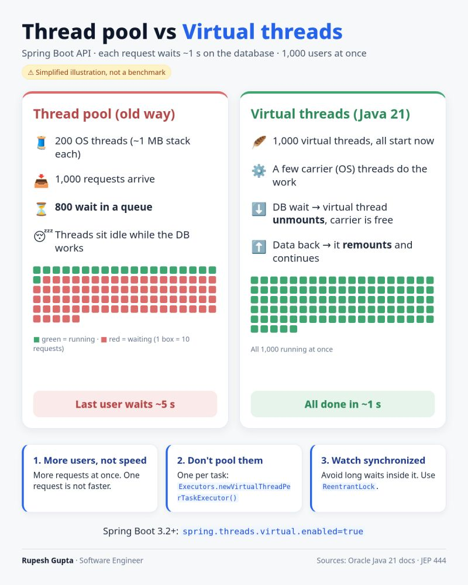
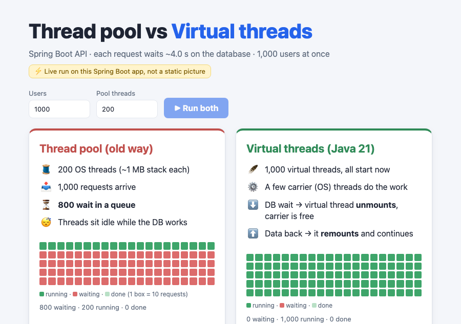
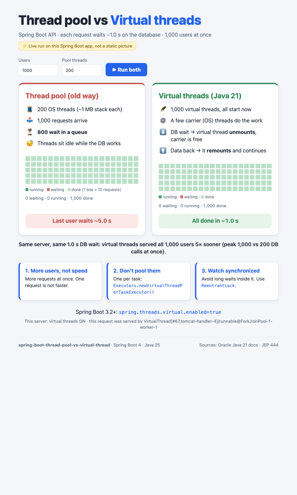

# Spring Boot: Thread pool vs Virtual threads

A runnable version of this diagram: a Spring Boot API where every request waits ~1 s on the database, hit by 1,000 users at once.



## Stack

- Java 25
- Spring Boot 4.1.1 (Spring MVC + Tomcat, Actuator)
- Maven

## Run

```bash
./mvnw spring-boot:run                                         # virtual threads (spring.threads.virtual.enabled=true)
./mvnw spring-boot:run -Dspring-boot.run.profiles=platform     # thread pool (old way): 200 Tomcat OS threads
```

## Run with Docker

```bash
docker compose up -d --build
```

| Service | URL | Mode |
|---|---|---|
| `virtual` | http://localhost:8080 | virtual threads (`spring.threads.virtual.enabled=true`) |
| `platform` | http://localhost:8081 | thread pool (`platform` profile, 200 Tomcat OS threads) |

Both use the same image. Set `DEMO_DB_LATENCY=4s docker compose up -d` to slow down the DB wait. Compare them with k6:

```bash
BASE_URL=http://localhost:8081 k6 run k6-load-test.js   # platform: avg 2.62 s, max 4.29 s
BASE_URL=http://localhost:8080 k6 run k6-load-test.js   # virtual:  avg 1.00 s, max 1.01 s
```

The image is a multi-stage build (JDK 25 for the build, JRE 25 at runtime), runs as a non-root user and splits the jar into Spring Boot layers so a code change doesn't re-ship the dependencies.

Stop everything with `docker compose down`.

## Web UI

Open **http://localhost:8080** and press **▶ Run both**. The page recreates the diagram with live data from the server: both strategies run side by side, and every box (= 10 requests) turns red (waiting), green (running) or pale green (done) as progress streams in over Server-Sent Events.

| While running | Finished |
|---|---|
|  |  |

Add `?run` to the URL to start a run on page load. Start the app with `--demo.db.latency=4s` to slow it down for a presentation.

## Endpoints

| Endpoint | What it does |
|---|---|
| `GET /api/users/{id}` | One request = one simulated ~1 s DB call. Response shows which thread served it. |
| `GET /api/compare?requests=1000&poolSize=200` | Runs the diagram's scenario in-process: fixed pool of 200 OS threads vs `Executors.newVirtualThreadPerTaskExecutor()`. |
| `GET /api/compare/live?requests=1000&poolSize=200` | Runs both strategies side by side and streams `progress` events (waiting/running/done every 100 ms) and a final `result` event. Used by the web UI. |
| `GET /api/stats` | Whether virtual threads are on, the current thread, and how many DB calls are in flight. |

The DB latency is configurable with `demo.db.latency` (default `1s`).

## Results (measured on a laptop)

### In-process: `GET /api/compare`

```json
{
  "dbLatencyMillis": 1000,
  "threadPool":     { "threads": 200, "totalMillis": 5027, "maxQueueWaitMillis": 4014, "peakConcurrent": 200,  "queuedAtStart": 800 },
  "virtualThreads": { "threads": -1,  "totalMillis": 1009, "maxQueueWaitMillis": 5,    "peakConcurrent": 1000, "queuedAtStart": 0 },
  "speedup": 5.0
}
```

Like the diagram: with the pool, **800 requests wait in the queue** and the last user waits **~5 s**. With virtual threads, **all 1,000 run at once** and finish in **~1 s**.

### Over HTTP with k6: `k6 run k6-load-test.js`

| Profile | avg | max | failed |
|---|---|---|---|
| `platform` (200 Tomcat threads) | 2.61 s | 4.27 s | 0 % |
| default (virtual threads) | 1.00 s | 1.01 s | 0 % |

The k6 script spreads the 1,000 arrivals over one second. On macOS the socket backlog is capped at `kern.ipc.somaxconn=128`, so 1,000 connections opened in the same instant get `connection reset by peer` from the kernel, whichever thread model you use.

## How it works

- **Thread pool**: `Thread.sleep` (standing in for JDBC) blocks a real OS thread. With 200 threads, requests 201–1,000 wait in the queue.
- **Virtual threads**: when a virtual thread blocks, it **unmounts** from its carrier (OS) thread, so the carrier is free to run other work. When the data comes back, it **remounts** and continues. A few carrier threads serve all 1,000 requests.

## The three rules from the diagram

1. **More users, not speed.** One request still takes ~1 s. Virtual threads only help throughput when the work is blocking I/O.
2. **Don't pool them.** Create one per task: `Executors.newVirtualThreadPerTaskExecutor()` (see `ThreadComparisonService`).
3. **Watch `synchronized`.** Avoid long waits while holding a monitor. Prefer `ReentrantLock` and keep the blocking call outside the lock (see `SlowUserRepository`). Since Java 24 ([JEP 491](https://openjdk.org/jeps/491)) `synchronized` no longer pins the carrier thread, but on Java 21–23 it does.

## Enabling it in your app

Spring Boot 3.2+:

```properties
spring.threads.virtual.enabled=true
```

## Tests

```bash
./mvnw test
```

The tests run a scaled-down version of the diagram: 100 users, 20 pooled threads and a 200 ms DB wait.
